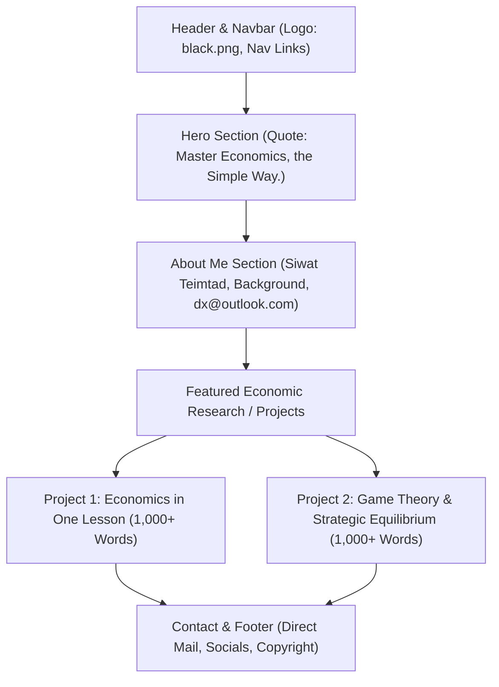

# Economist Portfolio Website Plan & Architecture

A blueprint for building and deploying a portfolio website for **Siwat Teimtad** on **GitHub Pages**.

---

## 1. Project Specifications Overview

| Item | Specification |
| :--- | :--- |
| **Name & Role** | Siwat Teimtad — Economist |
| **Email** | `dx@outlook.com` |
| **Design Style** | Modern Dark Theme (`#0a0d12`, `#121721`, `#1c2333` with emerald/cyan accent glow) |
| **Typography** | [JetBrains Mono](https://fonts.google.com/specimen/JetBrains+Mono) |
| **Hero Tagline** | *"Master Economics, the Simple Way."* |
| **Logo Asset** | `black.png` |
| **Projects (1,000+ words each)** | 1. *Economics in One Lesson* (Henry Hazlitt, 1946)<br>2. *Game Theory in Economics & Strategic Decision-Making* |
| **Hosting** | GitHub Pages (static HTML5/CSS3/JS, zero build dependencies) |

---

## 2. Information Architecture & File Structure

```text
my_first_website/
├── black.png                           # Brand logo
├── index.html                          # Single-page app with full navigation & sections
├── plan/
│   └── our_plan.md                     # Project plan and specifications
├── projects/
│   ├── economics-in-one-lesson.html    # Deep-dive essay (1,000+ words)
│   └── game-theory.html                # Deep-dive research paper (1,000+ words)
├── css/
│   └── style.css                       # JetBrains Mono styling, dark theme, responsive grid
└── js/
    └── main.js                         # Smooth scroll, active navbar, article reading mode/modals
```

---

## 3. UI/UX Section Breakdown



### 1. Header & Navigation
- Navbar with `black.png` brand logo and monospace brand badge.
- Navigation links: `About`, `Philosophy`, `Projects`, `Essays`, `Contact`.

### 2. Hero Section
- Bold statement with JetBrains Mono typography.
- Prominent quote: **"Master Economics, the Simple Way."**
- Subtext articulating core economic principles: clarity over jargon, empirical rigor, and second-order thinking.
- Quick action CTA buttons: *Explore Projects* and *Get in Touch*.

### 3. About Me & Contact Section
- Profile spotlight for **Siwat Teimtad**.
- Economist bio focusing on market design, public policy analysis, and behavioral mechanics.
- Contact cards with click-to-copy and direct `mailto:dx@outlook.com` action.

### 4. Project Showcase (Rich, 1,000+ Words Each)
1. **Economics in One Lesson — Henry Hazlitt (1946)**
   - *The Core Lesson*: Tracing long-term consequences across all groups (The Seen vs. The Unseen / Bastiat's Glazier).
   - *Broken Window Fallacy & Public Works*: Why destruction and artificial demand do not equal wealth creation.
   - *Price Controls & Tariff Distortions*: Market signals vs. bureaucratic intervention.
   - *Modern Relevance*: Inflationary monetary expansion, debt cycles, and unintended structural outcomes.
2. **Game Theory & Strategic Decision Making**
   - *Foundations of Non-Cooperative Games*: John Nash, payoff matrices, and Nash Equilibrium.
   - *The Prisoner’s Dilemma & Repeated Games*: Dominant strategies, cooperation thresholds, and Folk Theorem.
   - *Sequential Games & Subgame Perfection*: Backward induction, credible threats, and commitment devices.
   - *Applications in Economic Mechanism Design*: Auction theory, oligopoly competition (Cournot/Bertrand), and regulatory policy.

---

## 4. Implementation Steps

1. **Asset Preparation**:
   - Copy `black.png` into the project root.
2. **Core Styling (`style.css`)**:
   - Import Google Font `JetBrains Mono`.
   - Setup CSS variables for deep dark background, neon/emerald accents, syntax-style code blocks, and mathematical formula cards.
   - Responsive layout for mobile, tablet, and widescreen.
3. **HTML Construction (`index.html`, `projects/*.html`)**:
   - Semantic HTML5 structure with complete meta tags and OpenGraph tags for social sharing.
   - Embed full, structured content (>1,000 words per project) with callout boxes, diagrams, and key takeaway tables.
4. **Interactive JS (`main.js`)**:
   - Smooth navigation scrolling.
   - Reading progress bar & reading-time estimator.
   - Copy-email button with tooltip feedback.
5. **Git & GitHub Pages Deployment**:
   - Initialize git repo, commit files, connect to GitHub, and enable Pages in repository settings.

---

## 5. Deployment Checklist on GitHub Pages

1. Push all files (`index.html`, `projects/`, `css/`, `js/`, `black.png`) to the `main` branch.
2. Navigate to **GitHub Repo** $\rightarrow$ **Settings** $\rightarrow$ **Pages**.
3. Under **Branch**, select `main` and `/ (root)`.
4. Site goes live at `https://<username>.github.io/<repo-name>/`.
